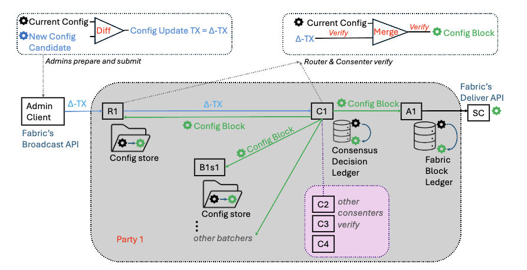
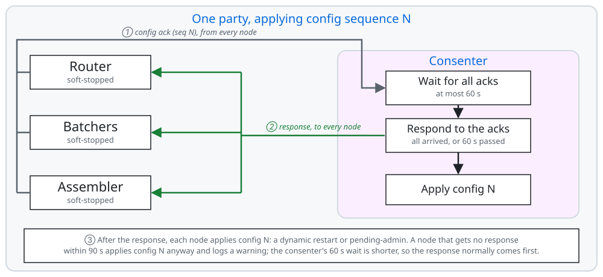
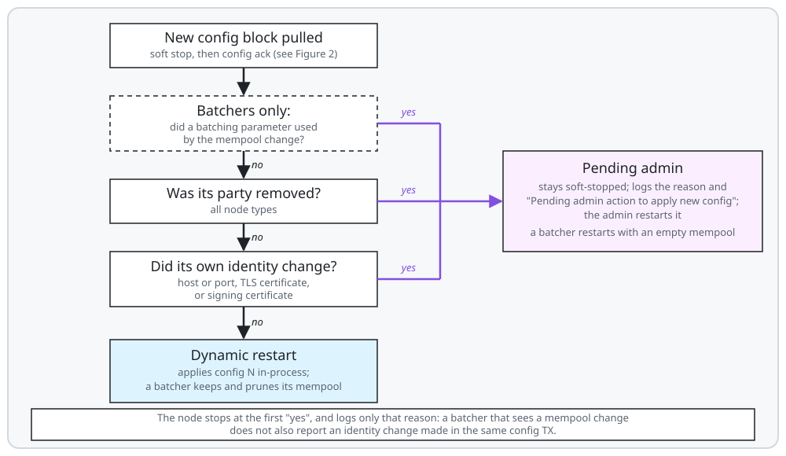

<!--
Copyright IBM Corp. All Rights Reserved.

SPDX-License-Identifier: Apache-2.0
-->
# Arma Reconfiguration Guide

*Audience: party administrators of an Arma ordering service, who prepare, sign and submit
configuration updates, and restart nodes when needed.*

This guide explains how to build, sign and submit a configuration update transaction (config TX),
and then describes the flow for each common change: consensus parameters, batching parameters,
endpoints, node certificates, CA certificates, and adding or removing a party.

For each change, the guide describes how every node reacts. A node either restarts **dynamically**
(in-process, no action needed) or enters the **pending-admin** state and waits for the admin to
restart it. For the configuration model this rests on, see
[Configuration and Membership](../architecture.md#6-configuration-and-membership).

1. [Overview](#1-overview)
2. [How a node reacts to a new config](#2-how-a-node-reacts-to-a-new-config)
3. [Rules every config update must follow](#3-rules-every-config-update-must-follow)
4. [Preparing a config TX with `fxadmin`](#4-preparing-a-config-tx-with-fxadmin)
5. [Configuration change flows](#5-configuration-change-flows)
   - [5.1 Update consensus (SmartBFT) parameters](#51-update-consensus-smartbft-parameters)
   - [5.2 Update batching parameters](#52-update-batching-parameters)
   - [5.3 Change a node endpoint](#53-change-a-node-endpoint)
   - [5.4 Rotate a node's TLS or signing certificate](#54-rotate-a-nodes-tls-or-signing-certificate)
   - [5.5 Rotate a party's CA certificates](#55-rotate-a-partys-ca-certificates)
   - [5.6 Remove a party](#56-remove-a-party)
   - [5.7 Add a party](#57-add-a-party)
6. [Troubleshooting: rejected config TXs](#6-troubleshooting-rejected-config-txs)
7. [Further Reading](#7-further-reading)

## 1. Overview

Arma uses the Hyperledger Fabric reconfiguration model. The configuration lives in config blocks
on the ledger; the genesis block is config block 0. To change anything (membership, endpoints,
certificates, parameters) the admins:

1. Fetch the **latest** config block.
2. Decode it to JSON and edit a copy.
3. Compute the config update (the delta between the original and the edited config).
4. Collect admin endorsements until the modification policy is met (see [Signing policy](#signing-policy)).
5. Wrap the endorsed update in an envelope signed by a channel writer, and submit it to the routers.
6. Wait until the new config block is committed and every node has applied the new config.
   A node either applies it on its own (dynamic restart), or waits in pending-admin for its admin
   to act (for example, update its local config and restart it). Check each node's log to see
   which one happened (see [Section 2](#2-how-a-node-reacts-to-a-new-config)).

What happens inside Arma after submission:

1. **Reception and validation.** A router receives the envelope over the `Broadcast` API. It checks
   the signatures against the policies, and checks the resulting config against the
   [orderer rules](#3-rules-every-config-update-must-follow). If either check fails, the
   router rejects the TX and returns the error to the submitter.
2. **Ordering.** The router forwards the config request to the consenters. The consenters check
   it again and order it in a decision of its own.
3. **Config block.** The assemblers write a new config block to the ledger. Its
   config sequence is one higher than the previous config.
4. **Apply.** Every node (router, batcher, consenter, assembler) pulls the decision that holds the
   config block, and soft-stops. Within each party, the nodes coordinate with their consenter
   before they apply the new config:
   - The router, the batchers and the assembler each send an acknowledgement (config ack) of the
     new config sequence to their party's consenter, and **wait for the consenter's response**.
   - The consenter waits up to 60 seconds for the acks of all of its party's router, batchers and
     assembler. When all have arrived, or when the 60 seconds are up, it responds to the nodes that
     acked and applies the new config itself.
   - A node that got the response applies the new config. If no response arrives within 90 seconds,
     the node applies the new config anyway and logs
     `did not receive the consenter's response to the ConfigAck for config sequence <N>, proceeding with the new config`.

   Each node then either restarts dynamically with the new config, or enters **pending-admin**
   (see [Section 2](#2-how-a-node-reacts-to-a-new-config)).



*Figure 1: The path of a config update through party 1. The admins compute the config update
(Δ-TX) as the difference between the current config and the new candidate, and the admin client
submits it to router R1 over Fabric's Broadcast API. R1 verifies it and forwards it to consenter C1;
C1 and the other consenters verify it again, decide on the new config block, 
and store it in their decision ledger. R1, the party's
batchers and assembler A1 each pull that decision from C1. R1 and the batchers add the config block it
holds to their config store, and A1 adds it to its block ledger, which clients read over Fabric's
Deliver API.*

<picture>
  <source media="(prefers-color-scheme: dark)" srcset="../figures/reconfig-config-ack-dark.svg">
  
</picture>

*Figure 2: The config ack flow within one party. The router, the batchers and the assembler,
soft-stopped, each send a config ack for the new config sequence to their consenter (①). The
consenter waits up to 60 seconds for all the acks, then sends a response back to every node that
acked (②), and applies the config itself. Each node applies the config after the response, or after
90 seconds without one (③).*

> **Use the latest config block as input.** A config update is computed against a specific config
> version. If it is built from an older block (for example, the genesis block after a
> reconfiguration has already happened), the routers reject it with
> `proposed update requires that key ... be at version N, but it is currently at version M`.
> After each successful reconfiguration, use the new config block for the next one.

## 2. How a node reacts to a new config

When a node pulls a new config block, it **soft-stops** and takes one of two paths. What each node
does internally is described in the Reconfiguration section of each role's doc:
[batcher](../batcher.md#7-reconfiguration), [consenter](../consensus.md#7-reconfiguration) and
[assembler](../assembler.md#7-reconfiguration).

| Outcome                | When                                                              | What the node does                                                                                   | What you must do                                                   |
|------------------------|-------------------------------------------------------------------|------------------------------------------------------------------------------------------------------|--------------------------------------------------------------------|
| **Dynamic restart**    | None of the pending-admin triggers below applies to this node     | Re-initializes in-process with the new config and resumes work. Clients are disconnected and must reconnect (see below) | Nothing. Check for the log line below.                             |
| **Pending admin**      | See the list below                                                | Stays soft-stopped and processes nothing. The assembler keeps serving `Deliver` of the blocks it already has | Prepare the node (local config / crypto), then **restart the process** |

A node enters **pending-admin** only when one of the following triggers occurs. All other changes,
including changes to the node's own party (for example, its party's `CACerts` / `TLSCACerts` or org
MSP, as in Steps 1 and 3 of CA rotation), trigger a dynamic restart instead:

- **Its own party was removed.** This applies to all node types.
- **Its own identity changed.** An identity change is any of:
  - its host or port (the `host`/`port` of this node's entry in `PartiesConfig`);
  - its TLS certificate (`tls_cert`);
  - its signing certificate (`sign_cert`).
- **Batchers only: a batching parameter used by the mempool changed** (see
  [5.2](#52-update-batching-parameters)). The batcher's memory pool cannot be reconfigured
  in-process, so **every batcher in the network** goes to pending-admin.

The first two triggers apply only to the node concerned. For example, a new router TLS certificate
for party 1 puts only party 1's router into pending-admin; all other nodes, including party 1's
other nodes, restart dynamically. The mempool trigger is the exception: it affects every batcher.

<picture>
  <source media="(prefers-color-scheme: dark)" srcset="../figures/reconfig-decision-dark.svg">
  
</picture>

*Figure 3: How a node decides between a dynamic restart and pending-admin*

**A dynamic restart is not invisible to clients.** When the router soft-stops, it closes every client
connection, and requests in flight may fail with `router is stopping, cannot process request`. When
the assembler restarts, it ends every open `Deliver` stream. Clients must reconnect once the node is
serving again. There is nothing for the admin to do, but clients should be able to retry.

A node logs only the **first** trigger it finds, and a batcher checks the mempool parameters before
its own identity. So if one TX changes a mempool parameter and also changes a batcher's identity
(for example, rotates its TLS certificate or moves its endpoint), that batcher logs only
`Batcher's pool options were changed in the new configuration`. Before you restart a batcher, check
the TX for other changes that affect it, and do the matching admin action too. For example, if the
TX also rotates the batcher's TLS certificate, first replace the certificate and key at
`General.TLS.Certificate` / `General.TLS.PrivateKey` with the new ones
(see [5.4](#54-rotate-a-nodes-tls-or-signing-certificate)). Otherwise the restart fails with
`certificate mismatch: ... differs from the shared configuration TLS certificate`.

### Log messages to look for

`<Node>` is one of `Router`, `Batcher`, `Consensus` or `Assembler`.

**Config ack, before the node applies the new config:**
```
Sending ConfigAck for config sequence <N> to consenter                                       # router, batcher, assembler
consenter responded to the config ack on config sequence <N>                                 # router, batcher, assembler
all acknowledgement have been received, it is safe to apply the new configuration            # consensus
consenter did not receive acknowledgments from all nodes on sequence <N>                     # consensus, after 60s without all acks
did not receive the consenter's response to the ConfigAck for config sequence <N>, proceeding with the new config   # router, batcher, assembler, after 90s
```
The last two lines mean a node of the party did not take part in time (for example, it is down).
The reconfiguration still proceeds.

**Dynamic restart (no action needed):**
```
Applying new config with sequence <N> (current: <N-1>), <node> will be restarted dynamically   # router, consensus, assembler
Reconfiguring batcher                                                                          # batcher
<Node> started with new config sequence <N>, listening on <host:port>                          # all nodes
```

On a dynamic restart, a batcher keeps its mempool, and re-verifies the requests waiting in it under
the new config. It drops the ones that no longer pass, for example requests signed by an identity
whose CA was removed, and logs `Mempool pruning completed: <n> transactions were dropped`. This does
not happen when a batcher goes to pending-admin: it is restarted by the admin with an empty mempool (see
[5.2](#52-update-batching-parameters)).

**Pending admin (action required).** The node logs the reason first, then the warning:
```
<Node>'s party <id> was evicted in the new configuration      # party removed
Nodes address changed: current=<old>, new=<new>               # endpoint changed
Nodes TLS certificate changed                                 # TLS cert changed
Nodes sign certificate changed                                # sign cert changed
Batcher's pool options were changed in the new configuration  # batching parameter used by the mempool changed (batcher only)
<Node>'s identity was changed in the new configuration
Pending admin action to apply new config
```
The assembler adds: `Pending admin action to apply new config. Assembler's deliver service remains available.`

**After an admin restart:** the node logs `<Node> listening on <host:port>` (the router also adds
`PartyID: <id>`). It loads the newer of two config blocks: the last one it stored (routers and
batchers in their config store, consenters and assemblers in their ledger) and the one in
`General.Bootstrap.File`. For a node that was running when the config changed, the stored block is
the newest, so you do **not** need to change `General.Bootstrap.File`.

A node that was **down** while config updates were committed also loads its stored config, which is
now outdated. It then catches up on what it missed, including the missed config blocks, and
applies them:

- a consenter syncs from the other consenters. It finds them through the consenter addresses and
  TLS CAs in its stored config, and switches to the new ones as it applies each missed config block;
- a router, batcher or assembler pulls the missed decisions only from its own party's consenter, at
  the address in its stored config, once that consenter has caught up.

So, in most cases, you do not need to change `General.Bootstrap.File` either. The exception is a
party that was down for an extended period of time while the network went through configuration
changes, so that its stored config no longer lets it reach the other consensus nodes. Then the party
must **rejoin**: set `General.Bootstrap.File` of each of the party's nodes to the latest config block
before you restart them (see
[Bringing back a party that was down during reconfigurations](#bringing-back-a-party-that-was-down-during-reconfigurations)).

**Removed party's nodes after a restart:** what happens depends on whether the node received the
config block that removed its party before it was stopped:

- **The node received it** (the party was running when it was removed, so its nodes entered
  pending-admin). On restart the node loads that config, does not find its own party in it, and
  exits at startup with a `panic:` line and a stack trace:
  ```
  panic: failed to extract consenter from config                                  # router
  panic: failed to extract router from config                                     # consensus
  panic: partyID <id> is not present in the shared configuration's party list     # batcher, assembler
  ```
- **The node did not receive it** (the party was already stopped when it was removed). On restart
  the node loads its older config, which still lists its party, so it starts. But the other
  parties no longer trust it, so its connections to them fail, for example
  `tls: unknown certificate authority`.

Both outcomes are expected: the network no longer trusts that party.

### How to restart a node

Stop the process gracefully (SIGTERM), make the local changes the change requires, and start it again
with the same command:

```bash
arma <router|batcher|consensus|assembler> --config <path>/local_config_<node>.yaml
```

The local config fields you may need to change are under `General`. Each field is documented in
[`local_config.yaml`](../../config/sample/local_config.yaml):

| Change in the config TX          | Edit in `local_config_<node>.yaml` before restarting                                                            |
|----------------------------------|----------------------------------------------------------------------------------------------------------------|
| Node port                        | `General.ListenPort`                                                                                           |
| Node host                        | `General.ListenAddress`, only if it is a specific IP and the node moved to a machine with a new IP. Nothing if it is `0.0.0.0`, or if only the external address or DNS name changed. See [5.3](#53-change-a-node-endpoint) |
| Node TLS certificate             | Put the new cert/key at `General.TLS.Certificate` / `General.TLS.PrivateKey` (or point these fields at the new files) |
| Node signing certificate         | Put the new cert in `<General.LocalMSPDir>/signcerts/` and its key in `<General.LocalMSPDir>/keystore/priv_sk` |
| Party CA certificates            | Update the CA files the node trusts, such as `General.TLS.RootCAs` and `<LocalMSPDir>/cacerts`, `tlscacerts` |

## 3. Rules every config update must follow

The routers and consenters check every config TX before it is ordered. If a rule is violated, the
router rejects the TX and returns an error to the submitter. The network is not affected.

**Transition rules** (current config to new config):

1. **One party change per config TX.** In one TX you may add one party, *or* remove one party, *or*
   modify one party, but not more than one of these. Parameters that are not per-party
   (consensus, batching) can go into any TX.
2. **New party IDs are never reused.** A new party's `PartyID` must be `MaxPartyID + 1`, and
   `MaxPartyID` must be set to it in the same TX. If no party is added, `MaxPartyID` must not change.
3. **A party's set of batcher shards cannot change.**
4. **The channel ID cannot change.**
5. **Certificates must chain to the party's CAs.** Every node certificate (TLS and signing) is
   checked against the party's `TLSCACerts` / `CACerts`. Expiration is checked only for the party
   being added or modified.
6. **IDs must be in range.** Party IDs and `MaxPartyID` must be between 1 and 65535, and shard IDs
   between 1 and 65534.

**Consistency rules** (several values appear in more than one place in the config, and every copy
must match). The **Validated** column says whether the orderer rejects a TX that breaks the rule.
A rule marked **no** is not enforced: the TX is accepted, so you must keep the copies in sync yourself.

| If you change...                               | ...you must also update                                                                                                         | Validated |
|------------------------------------------------|----------------------------------------------------------------------------------------------------------------------------------|-----------|
| A consenter's `host` / `port`                  | The party's entry in `Orderer.values.Orderers.value.consenter_mapping` (`host`, `port`)                                          | yes       |
| A consenter's `tls_cert`                       | `consenter_mapping` (`client_tls_cert`, `server_tls_cert`)                                                                       | yes       |
| A consenter's `sign_cert`                      | `consenter_mapping` (`identity`) **and** the `Orderer.policies.BlockValidation` policy                                           | yes       |
| The set of parties (add / remove)              | `consenter_mapping`, the orderer org under `Orderer.groups`, **and** the `BlockValidation` policy (BFT quorum over the consenters) | yes       |
| A party's `TLSCACerts`                         | The org MSP `tls_root_certs` under `Orderer.groups.<org>`                                                                        | yes       |
| A party's `CACerts`                            | The org MSP `root_certs` under `Orderer.groups.<org>`                                                                            | **no**    |
| MSP `fabric_node_ous` (when enabled) | NodeOU CA certificates must be in the party's `CACerts`, and node `sign_cert`s must pass MSP validation | yes |
| A router `host`/`port` or assembler `host`/`port` | The org `Endpoints` (`broadcast` = router, `deliver` = assembler) under `Orderer.groups.<org>`, unless clients reach the node at a different (external) address; see below | **no** (a mismatch is only logged as a warning) |
| `BatchingConfig.BatchSize.AbsoluteMaxBytes`    | `Orderer.values.BatchSize.value.absolute_max_bytes` must be equal. If you lower it, `Orderer.values.BatchSize.value.preferred_max_bytes` must stay `<=` it | yes |
| `BatchingConfig.RequestMaxBytes`               | `ConsensusConfig.SmartBFTConfig.RequestMaxBytes` must stay `>=` it                                                               | yes       |

**Router and assembler endpoints: when a mismatch matters.** The two copies are read by different
parties:

- The `host` / `port` in `PartiesConfig` (`RouterConfig`, `AssemblerConfig`) is the node's internal
  address: other Arma nodes connect to it, and `fxadmin` reads it.
- The org `Endpoints` are the addresses for clients: clients that find the routers and assemblers
  from the config block connect to these.

The orderer only warns on a mismatch because the two may differ on purpose: when the node is behind
NAT, a load balancer or a proxy, clients reach it at an external address (and possibly port) that is
not the node's internal one. In that case, keep the org `Endpoints` set to the external address, and
change it only when the external address changes.

When there is no such translation, clients reach the node at its internal address, so the two copies
must be the same. Then a mismatch is a mistake. For example, if you change a router's port in
`PartiesConfig` but not in the org's `Endpoints`, the TX is accepted, but clients keep dialing the
old port and can no longer reach the router.

Also: all batching timeouts must be positive durations, and the SmartBFT config must pass
SmartBFT's own validation.

### Signing policy

The config TX must carry enough admin signatures to satisfy the modification policy (`mod_policy`)
of **every element it changes**. Which admins are needed depends on the policies in your channel
config. Check them in the decoded config before you collect signatures.

Every element changed by the flows in this guide has `mod_policy: Admins`. `Admins` is resolved in
the group that holds the element:

- **Orderer-level elements:** the shared config (`ConsensusType`: parameters, `PartiesConfig`,
  `MaxPartyID`), `Orderers` (`consenter_mapping`) and the `BlockValidation` policy. They are governed
  by `/Channel/Orderer/Admins`. Its rule is in `.channel_group.groups.Orderer.policies.Admins`.
  In most cases the rule is `MAJORITY Admins`: a majority of the orderer orgs' admins must sign.
- **Org-level elements:** `Orderer.groups.<org>`, i.e. the org's `MSP` and `Endpoints`. They are
  governed by that org's own `Admins` policy. Its rule is in
  `.channel_group.groups.Orderer.groups.<org>.policies.Admins`. By default it is satisfied only by
  that org's admin.

The network can define different rules. For example, the orderer `Admins` policy can be `ANY Admins`
or `ALL Admins`, or a custom signature policy. In that case, follow the rules in your config.

**Each changed element is checked separately.** The orderer checks the TX's signatures against the
`mod_policy` of every element the TX changes, and rejects the TX if any one of these checks fails.
So when a TX changes elements at both levels, its signatures must satisfy both policies.

This is the case for router and assembler endpoints, and for CA rotation. Each of these changes the
party's entry in the shared config (an orderer-level element) **and** the party's org group: the
`Endpoints` for an endpoint, the `MSP` for a CA. With the default policies, the TX therefore needs a
majority of the orderer admins, **and** that party's admin must be one of them.

For example, with 4 parties a majority is 3 admins. A TX that changes party 1's router endpoint:

| Signers (admins of parties) | Result                                                                  |
|-----------------------------|-------------------------------------------------------------------------|
| 1, 2, 3                     | Accepted: a majority, and it includes `org1`'s admin                     |
| 2, 3, 4                     | Rejected: a majority, but `org1`'s `Endpoints` policy is not satisfied   |
| 1                           | Rejected: `org1`'s policy is satisfied, but there is no majority         |

A change that touches only the shared config (for example, a batcher or consenter endpoint) needs
only the majority. A TX that changes **only** an org group (for example, only an org's MSP
`known_certs`) needs only that org's admin; a majority of the other admins cannot sign it instead.

A TX that does not meet the policy is rejected with, for example:
```
1 sub-policies were satisfied, but this policy requires 3 of the 'Admins' sub-policies to be satisfied
policy for [Value]  /Channel/Orderer/org1/Endpoints not satisfied: signature set did not satisfy policy
```

## 4. Preparing a config TX with `fxadmin`

Use **`fxadmin`**, the Fabric-X reconfiguration admin CLI, to fetch the latest config block, decode
it, compute the update, collect endorsements, submit the config TX, and wait for the commit.
The build, the admin configuration file and every command are described in the
[fxadmin documentation](https://github.com/hyperledger/fabric-x/blob/main/tools/fxadmin/docs/README.md).

In short:

1. `fxadmin ledger ... config latest` fetches the latest config block. On the first
   reconfiguration, pass the genesis block as `--current-block`; afterwards, the latest config block.
2. `fxadmin decode` turns it into JSON. Copy the JSON and edit the copy as described in
   [Section 5](#5-configuration-change-flows).
3. `fxadmin compute-update` computes the config update from the original and edited JSON.
4. `fxadmin tx endorse` is run by each signing admin; `fxadmin tx merge` combines the endorsements.
5. `fxadmin tx send` signs the TX as a channel writer and submits it to all routers. It succeeds
   only if a BFT quorum (2f+1) of the routers accepts it.
6. `fxadmin follow` waits until the new config block is committed by the assemblers and writes it
   to a file. Use that block as `--current-block` for the next reconfiguration, and as the
   bootstrap block for a party that joins later.

### Where things are in the decoded config

All Arma shared configuration is under
`.channel_group.groups.Orderer.values.ConsensusType.value.metadata` (written `<shared>` below).
Field names are exactly as they appear in the JSON.

| What                                   | JSON path                                                                                       |
|----------------------------------------|-------------------------------------------------------------------------------------------------|
| Parties (endpoints, certs, CAs)        | `<shared>.PartiesConfig[]`: `PartyID`, `CACerts`, `TLSCACerts`, `RouterConfig`, `AssemblerConfig`, `ConsenterConfig`, `BatchersConfig[]` |
| A node entry                           | `host`, `port`, `tls_cert`, `sign_cert` (batchers also have `shardID`)                           |
| Highest party ID ever used             | `<shared>.MaxPartyID`                                                                            |
| Batching parameters                    | `<shared>.BatchingConfig`: `BatchSize.{MaxMessageCount,AbsoluteMaxBytes}`, `BatchTimeouts.{BatchCreationTimeout,FirstStrikeThreshold,SecondStrikeThreshold,AutoRemoveTimeout}`, `RequestMaxBytes` |
| SmartBFT parameters                    | `<shared>.ConsensusConfig.SmartBFTConfig.*`                                                      |
| Fabric batch size                      | `.channel_group.groups.Orderer.values.BatchSize.value`: `max_message_count`, `absolute_max_bytes`, `preferred_max_bytes` |
| Consenter mapping                      | `.channel_group.groups.Orderer.values.Orderers.value.consenter_mapping[]`: `id`, `host`, `port`, `identity`, `client_tls_cert`, `server_tls_cert`, `msp_id` |
| Block signature policy                 | `.channel_group.groups.Orderer.policies.BlockValidation`                                         |
| Orderer org of party `N`               | `.channel_group.groups.Orderer.groups.orgN`: `values.MSP.value.config.{root_certs,tls_root_certs,admins,known_certs,fabric_node_ous}`, `values.Endpoints.value.addresses` |

Certificates in the JSON are base64-encoded PEM, on one line.

The **`BlockValidation` policy** must be a BFT quorum over the current consenters: a `n_out_of`
rule whose `n` is `ceil((N + f + 1) / 2)` (with `N` consenters and `f = (N-1)/3`), and one
`IDENTITY` principal per consenter, made of its `msp_id` and its `identity` (signing certificate)
from `consenter_mapping`. Rebuild it whenever the set of consenters or a consenter's signing
certificate changes.

## 5. Configuration change flows

The flows use **party 1** as the party being changed, in a network of 4 parties, unless noted otherwise.
The **Sign** lines assume the default policies (see [Signing policy](#signing-policy)). If your
network uses different policies, collect the signatures those policies require.

### 5.1 Update consensus (SmartBFT) parameters

**Edit:** change the parameter under `<shared>.ConsensusConfig.SmartBFTConfig`. Keep the type the
decoded config uses: numeric values are JSON strings (for example `"1048576"`), and durations look
like `"2s"`. If you lower `SmartBFTConfig.RequestMaxBytes`, it must stay `>=`
`BatchingConfig.RequestMaxBytes`.

**Sign:** majority of the orderer org admins.

**Node behavior:** **all nodes restart dynamically.** No admin action is needed.

**What you should see:** every node logs `... started with new config sequence <N>`. Clients
reconnect to the routers and assemblers, and transactions keep flowing.

### 5.2 Update batching parameters

The batching parameters are in `<shared>.BatchingConfig`. Each batcher builds its memory pool
(mempool, see [The Memory Pool and Censorship Resistance](../batcher.md#34-the-memory-pool-and-censorship-resistance))
from most of them: the largest request the mempool accepts, the most requests and bytes it puts in
one batch, and the timeouts that protect against a censoring primary. The mempool cannot be
reconfigured in-process, so a change to any of these parameters makes the batchers wait for an
admin restart.

| Parameter                                    | Where                                    | Also update                                                         | Used by the mempool |
|----------------------------------------------|------------------------------------------|---------------------------------------------------------------------|:-------------------:|
| `BatchSize.MaxMessageCount`                  | `<shared>.BatchingConfig.BatchSize`      |                                                                     | yes                 |
| `BatchSize.AbsoluteMaxBytes`                 | `<shared>.BatchingConfig.BatchSize`      | `absolute_max_bytes` in `Orderer.values.BatchSize` (**must** be equal). When lowering it, `preferred_max_bytes` there must stay `<=` it | yes |
| `RequestMaxBytes`                            | `<shared>.BatchingConfig`                | `SmartBFTConfig.RequestMaxBytes` if needed, to stay `>=` it         | yes                 |
| `BatchTimeouts.FirstStrikeThreshold`         | `<shared>.BatchingConfig.BatchTimeouts`  |                                                                     | yes                 |
| `BatchTimeouts.SecondStrikeThreshold`        | `<shared>.BatchingConfig.BatchTimeouts`  |                                                                     | yes                 |
| `BatchTimeouts.AutoRemoveTimeout`            | `<shared>.BatchingConfig.BatchTimeouts`  |                                                                     | yes                 |
| `BatchTimeouts.BatchCreationTimeout`         | `<shared>.BatchingConfig.BatchTimeouts`  |                                                                     | no                  |

`BatchCreationTimeout` is the longest the primary batcher waits for a batch to fill before it cuts
a smaller one. `BatchingConfig.BatchSize.PreferredMaxBytes` is not used by Arma. All timeouts must
be positive durations (for example `"500ms"`).

The mempool's size and submit timeout (`MemPoolMaxSize`, `SubmitTimeout`) are not in the config
block. They are in each batcher's local config (`Batcher` section of `local_config_batcher<S>.yaml`),
and change only with a batcher restart.

**Sign:** majority of the orderer org admins.

**Node behavior:**

| Node                                  | Behavior                                                                                       |
|---------------------------------------|------------------------------------------------------------------------------------------------|
| Routers, consenters, assemblers       | Dynamic restart                                                                                 |
| **All batchers** (every party, every shard) | **Pending admin** if a parameter used by the mempool changed. Each logs `Batcher's pool options were changed in the new configuration`. If only `BatchCreationTimeout` changed: dynamic restart |

**Admin action (each party admin, for each of their batchers),** when a parameter used by the mempool changed:

1. Wait for the batcher to log `Batcher's pool options were changed in the new configuration` and
   `Pending admin action to apply new config`.
2. Restart the batcher process. It loads the new parameters from its config store.
3. Check for `Batcher listening on <host:port>`.

Until the batchers are restarted, they do not batch transactions, so the network does not order
new transactions. Coordinate the restart across all parties.

**What you should see:** after the restart, new blocks follow the new parameters. For example, with
`MaxMessageCount = 2`, no block holds more than 2 transactions, and a router rejects a request
larger than the new `RequestMaxBytes`. The mempool is not persisted
([Restarting from Local State](../batcher.md#61-restarting-from-local-state)), and in this flow every
batcher restarts, so the requests that were waiting in the mempools and not yet in a batch are lost.
Clients must resubmit the requests that were not included in a block.

### 5.3 Change a node endpoint

The flow is the same for any node. Only the node whose endpoint changes needs admin action.

**If the host changes:** the node's TLS certificate must list the new host in its SANs. Other
nodes and clients check the host name they dial against the node's certificate. The config TX
itself is accepted either way, because the orderer validates the certificate's CA chain and key
usage, not its SANs. But after the restart, every TLS handshake with the node fails with
`x509: certificate is valid for <old>, not <new>`, and the node is cut off. If the current
certificate does not cover the new host, rotate the node's TLS certificate
([5.4](#54-rotate-a-nodes-tls-or-signing-certificate)) in the same TX. Both changes modify the same
party, so the TX is allowed.

**Edit:** set the node's `host` / `port` in its entry in `<shared>.PartiesConfig[]` (party 1), and:

| Node                 | Also update                                                                                       |
|----------------------|---------------------------------------------------------------------------------------------------|
| Router               | `org1`'s `Endpoints`: the `broadcast` address (`id=1,broadcast,<host>:<port>`). Clients connect to this address. If clients connect to the router directly, set it to the new `host`/`port`. If clients connect through NAT or a DNS name, leave it unless that address changes. **The orderer doesn't check this:** if you forget it, the TX is still accepted, and clients keep connecting to the old address |
| Assembler            | `org1`'s `Endpoints`: the `deliver` address (`id=1,deliver,<host>:<port>`). Clients connect to this address. If clients connect to the assembler directly, set it to the new `host`/`port`. If clients connect through NAT or a DNS name, leave it unless that address changes. **The orderer doesn't check this:** if you forget it, the TX is still accepted, and clients keep connecting to the old address |
| Consenter            | `host` / `port` of party 1's entry in `consenter_mapping`                                          |
| Batcher of shard S   | Nothing else                                                                                      |

**Sign:** majority of the orderer org admins. For a router or assembler endpoint, party 1's admin
must be one of them, because the edit changes `org1`'s `Endpoints` (see [Signing policy](#signing-policy)).

**Node behavior:**

| Node                                          | Behavior                                                                  |
|-----------------------------------------------|---------------------------------------------------------------------------|
| The node whose endpoint changed               | **Pending admin.** Logs `Nodes address changed: current=<old>, new=<new>` |
| All other nodes, in all parties               | Dynamic restart. They connect to the new address                          |

**Admin action (party 1's admin):**

1. Wait for `Pending admin action to apply new config` on the changed node, then stop it.
2. Update the node's `local_config_<node>.yaml`:
   - **If the port changed:** set `General.ListenPort` to the new port.
   - **If the host changed:** the `host` in the config block and `General.ListenAddress` in the local
     config are not the same thing:
     - the `host` is the address the **other parties' nodes** connect to. If party 1's nodes are
       behind NAT or a DNS name, it is that external address or name;
     - `General.ListenAddress` is the local IP address on the node's own machine where it opens its
       port. It must be one of the machine's IP addresses, or `0.0.0.0` for all of them. It can't be
       a DNS name or an external NAT address.

     What to do:
     - If `ListenAddress` is `0.0.0.0`, don't change it.
     - If `ListenAddress` is the machine's IP and the node moved to a machine with a new IP,
       set it to the new IP. Otherwise the node can't start.
     - If only the external address or DNS name changed and the machine is the same, the config TX
       updates the `host`, but you don't change `General.ListenAddress`: the node still listens on
       the same local IP. The node still goes to pending-admin, because its address changed, and you
       must still restart it.
3. Start the node and check for `<Node> listening on <ListenAddress>:<ListenPort>`. This line shows
   the local address the node listens on, not the `host` from the config block.
4. **Router or assembler:** tell clients to use the new address. Clients cannot reach the node
   at the old address after the change.

**What you should see:** the other nodes log `started with new config sequence <N>`.
Transactions sent to the new address are processed and appear in blocks pulled from all assemblers.

### 5.4 Rotate a node's TLS or signing certificate

Use this flow when a node gets a new certificate **from the same CA** (for example, renewal before
expiry). If the CA itself changes, use [5.5](#55-rotate-a-partys-ca-certificates).

Every node (router, batcher, consenter, assembler) has a `tls_cert` and a `sign_cert` in the shared
config.

**Prepare:** issue the new certificate(s) from the party's TLS CA (for TLS) or signing CA (for
signing).

**Edit:** set the node's `tls_cert` and/or `sign_cert` in its entry in `<shared>.PartiesConfig[]`. For a
consenter, also update party 1's entry in `consenter_mapping`:

- new `tls_cert` → `client_tls_cert` and `server_tls_cert`;
- new `sign_cert` → `identity`, and rebuild the `BlockValidation` policy
  (see [Where things are in the decoded config](#where-things-are-in-the-decoded-config)).

You may rotate several certificates of **the same party** in one TX, for example all of a party's
certificates at once.

**Sign:** majority of the orderer org admins.

**Node behavior:**

| Node                                          | Behavior                                                                      |
|-----------------------------------------------|-------------------------------------------------------------------------------|
| Each node whose certificate changed           | **Pending admin.** Logs `Nodes TLS certificate changed` / `Nodes sign certificate changed` |
| All other nodes, in all parties               | Dynamic restart. They trust the new certificate                               |

**Admin action (party 1's admin, for each changed node):**

1. Wait for `Pending admin action to apply new config`, then stop the node.
2. Replace the certificate and key with the new ones:
   - TLS: at `General.TLS.Certificate` / `General.TLS.PrivateKey`;
   - signing: `<General.LocalMSPDir>/signcerts/` and `<General.LocalMSPDir>/keystore/priv_sk`.
3. Start the node and check for `<Node> listening on ...`.

**What you should see:** after the restart, the node connects to the rest of the network with the
new certificate. The router logs `Pulled config block number ...`, the batcher logs
`Got config block number ...`, and the assembler logs `Started pulling blocks from: shard<S>party<P>`.
Transactions are processed.

### 5.5 Rotate a party's CA certificates

Replacing a party's signing CA and/or TLS CA takes **three config TXs**. Every step keeps the
network running, because each step only removes trust in a CA once nothing depends on it.

**Prepare:** create the new CAs (signing CA and TLS CA) for party 1. From them, issue a new set of
node certificates (TLS and signing for every node of the party), and new admin and client certificates.

**Step 1: Trust the new CAs alongside the old ones.**

- **Edit:** append the new signing CA to party 1's `CACerts` and to `org1`'s MSP `root_certs`.
  Append the new TLS CA to party 1's `TLSCACerts` and to `org1`'s MSP `tls_root_certs`.
- **Sign:** majority, including party 1's admin (the edit changes `org1`'s `MSP`).
- **Node behavior:** **all nodes restart dynamically.** Node identities do not change.

**Step 2: Switch party 1's nodes to certificates from the new CAs.**

- **Edit** (on the latest config block): replace the `tls_cert` and `sign_cert` of **every** node
  of party 1, as in [5.4](#54-rotate-a-nodes-tls-or-signing-certificate) (including the consenter's
  `consenter_mapping` entry and the `BlockValidation` policy). In the same TX, point `org1`'s MSP at
  the new signing CA:
  - with node OUs (the default): set the `certificate` of each identifier in
    `fabric_node_ous` (`client`, `peer`, `admin`, `orderer`) to the new signing CA;
  - without node OUs (`admincerts` mode): replace `org1`'s MSP `admins` with the new admin certificate.
- **Sign:** majority, including party 1's admin. Party 1's admin signs with the **old** admin
  identity: an identity from the new CA is only trusted after this TX commits.
- **Node behavior:** **all of party 1's nodes go to pending-admin** (identity changed). All other
  nodes restart dynamically.
- **Admin action (party 1):** stop each node. Replace its TLS and signing certificates and keys with
  the new ones, and add the new CA files to its MSP and TLS trust lists. Then restart it. From now
  on, party 1's admin and clients use their identities from the new CA.

**Step 3: Remove the old CAs.**

- **Edit** (on the latest config block): set party 1's `CACerts` / `TLSCACerts`, and `org1`'s MSP
  `root_certs` / `tls_root_certs`, to the new CAs only. In the same TX, replace `org1`'s MSP
  `known_certs` with the certificates issued by the new CA (the `msp/knowncerts` of the new crypto
  material). Otherwise the old known certificates no longer chain to a trusted CA.
- **Sign:** majority, including party 1's admin (with the new admin identity).
- **Node behavior:** **all nodes restart dynamically.**
- **What you should see:** the network keeps processing transactions. A transaction signed by an
  identity issued by the **old** CA is now rejected with `signature did not satisfy policy`.

If Step 2 was skipped or incomplete (a node still has a certificate from the old CA, or the node OUs
still point at the old CA), Step 3 is rejected and the network is unchanged. Complete Step 2 and retry.

### 5.6 Remove a party

This example removes **party 4**. Only one party can be removed per config TX. To remove
several, run this flow once per party.

**Before you remove a party, check that the network stays live.** The orderer does not check
whether the remaining parties can still reach a quorum. After the removal, with `N` remaining
parties, `f = (N-1)/3` and a quorum of `ceil((N + f + 1) / 2)` parties must be up. For example, in a
network of 5 parties with party 2 down, removing party 5 leaves `N = 4`, `f = 1` and a quorum of 3,
while only parties 1, 3 and 4 are up: one more failure stops ordering. Confirm which parties are
healthy before you remove one.

**Edit:** in the same TX:

- remove party 4's entry from `<shared>.PartiesConfig[]`;
- remove party 4's entry from `consenter_mapping`;
- remove the `org4` group from `.channel_group.groups.Orderer.groups`;
- rebuild the `BlockValidation` policy over the remaining consenters.

`MaxPartyID` does not change, so ID 4 can never be used again.

**Sign:** a majority of **all** the orderer orgs' admins, counted over the config **before** the
removal.

**Before you submit (optional):** you may stop party 4 first. If it is already stopped, submit to
the remaining routers; `fxadmin tx send` succeeds as long as a quorum of routers accepts the TX.

**Node behavior:**

| Node                                  | Behavior                                                                                         |
|---------------------------------------|--------------------------------------------------------------------------------------------------|
| All nodes of party 4                  | **Pending admin.** Each logs `<Node>'s party 4 was evicted in the new configuration`              |
| All nodes of the remaining parties    | Dynamic restart. They stop accepting connections from party 4                                     |

**Admin action:**

- **Party 4's admin:** stop all of party 4's processes and take them out of service.
  If they are restarted, they fail at startup, or they cannot connect
  (`tls: unknown certificate authority`). This is expected.
- **Everyone:** remove party 4's router and assembler from client configurations.

**What you should see:** the remaining parties log `started with new config sequence <N>`.
Transactions sent to the remaining routers are processed, and the remaining assemblers
deliver all blocks. In the new config block, `PartiesConfig` no longer lists party 4. Removing a
party starts a new term in every shard, so the batcher primaries may change: the batchers log
`Primary changed from <old> to <new>`.

### 5.7 Add a party

This example adds **party 5** to a network of parties 1–4. Only one party can be added per config TX.

**Prepare (new party's admin):**

1. Generate the new party's crypto material: CA and TLS CA, a TLS and a signing certificate for
   each node (the router, one batcher per **existing** shard, the consenter and the assembler),
   and the org's admin and client certificates. Also create the local config for each node.
2. Read the current `MaxPartyID`. The new party's ID must be `MaxPartyID + 1`. This may not be
   "number of parties + 1" if a party was removed earlier.
3. Send the existing admins the party's endpoints, certificates and CAs.

**Edit (existing admins):** in the same TX:

- set `<shared>.MaxPartyID` to 5;
- add a party 5 entry to `<shared>.PartiesConfig[]` with `CACerts`, `TLSCACerts`, and the
  `host`, `port`, `tls_cert` and `sign_cert` of its router, assembler, consenter and batchers;
- add a party 5 entry to `consenter_mapping`: `id` 5, `msp_id` `org5`, the consenter's `host` and
  `port`, its signing certificate as `identity`, and its TLS certificate as `client_tls_cert` and
  `server_tls_cert`;
- add an `org5` group under `.channel_group.groups.Orderer.groups` (an existing org group is a good
  template). Set its MSP `name` to `org5`, and the `msp_identifier` of its policies to `org5`.
  Set its MSP `root_certs` / `tls_root_certs` to the new party's CAs, and `known_certs` to the new
  org's certificates. With node OUs, point every `fabric_node_ous` identifier at the new signing CA;
  without node OUs, set `admins` to the new admin certificate. Set its `Endpoints` to
  `id=5,broadcast,<router host:port>` and `id=5,deliver,<assembler host:port>`;
- rebuild the `BlockValidation` policy over all five consenters.

**Sign:** majority of the **existing** parties' admins. The new party has no say yet.

**Node behavior:** **all existing nodes restart dynamically.** No admin action is needed on the
existing parties.

**Admin action (new party's admin):**

1. Get the **config block that added party 5** (for example with `fxadmin follow`).
2. In the local config of **every** party 5 node, set `General.Bootstrap.Method: block` and
   `General.Bootstrap.File` to that block. Do **not** use the genesis block, because it does not list party 5.
3. Start party 5's nodes and check for `<Node> listening on ...`. The new nodes sync the ledger from the
   other parties. This may take a while, so give the consenter time to join the consensus cluster
   before sending traffic through it.

**What you should see:** party 5's assembler delivers blocks up to and including the config block
with the new sequence. A transaction submitted to party 5's router is processed, and it appears in
blocks pulled from all assemblers. Adding a party starts a new term in every shard, so the batcher
primaries may change: the batchers log `Primary changed from <old> to <new>`.

> **Replacing a party** (remove one, add another) takes at least two config TXs. Use the config
> block produced by the **latest** TX as the new party's bootstrap block.

#### Bringing back a party that was down during reconfigurations

A party that missed config updates while it was down usually needs no action: on restart, its
consenter syncs the missed blocks from the other consenters, and its router, batchers and assembler
pull the missed decisions from it.

**When must the party rejoin?** When a party is down for an extended period of time, and the
network goes through configuration changes, the party might not be able to join the cluster when it
restarts. For example, the endpoints or certificates of all the other consensus nodes have changed
while it was down. Its consenter can reach and trust the other consenters only through the addresses
and certificates in its stored config. When none of them are still valid, it can't sync, and stays
on its old config. It then rejects the BAFs that batchers send under the newer config
(`Failed submitting request: config sequence ahead; the BAF's config seq is ...`), and the whole
party stays out of the network.

**How to rejoin:** put the latest config block on the file system of **every** node of the party,
point `General.Bootstrap.File` at it, and restart the nodes. Each node detects that this block is
newer than the last config block it stored (a **rejoin block**), and logs `rejoin-block detected`.
It then uses the rejoin block to connect to the network and catch up; the consenter syncs with the
cluster before it takes part.

The bootstrap block is used in three cases:

| Case                     | `General.Bootstrap.File`                                        |
|--------------------------|-----------------------------------------------------------------|
| First start of a network | The genesis block                                               |
| A new party joins        | The config block that added the party ([5.7](#57-add-a-party))  |
| A party rejoins          | The latest config block                                         |

## 6. Troubleshooting: rejected config TXs

The router returns these errors to the submitter. The network is unchanged; fix the config and submit again.

| Error (excerpt)                                                                                   | Cause / fix                                                                                       |
|---------------------------------------------------------------------------------------------------|---------------------------------------------------------------------------------------------------|
| `N sub-policies were satisfied, but this policy requires M of the 'Admins' sub-policies`          | Not enough admin endorsements. Collect the signatures the policy requires (with the default policy, a majority) |
| `policy for [Value] /Channel/Orderer/orgN/... not satisfied`                                      | You changed org N's group without org N's admin among the signers                                  |
| `signature did not satisfy policy /Channel/Writers`                                               | The envelope's outer signature is invalid or not from a channel writer                            |
| `proposed update requires that key ... be at version N, but it is currently at version M`          | The update was built from an old config block. Fetch the latest and rebuild                        |
| `more than one party added / removed / modified in config tx`, `only one party can be changed`    | Split the change into one TX per party                                                            |
| `proposed MaxPartyID X must equal the newly added PartyID Y`                                      | `MaxPartyID` was not set to the new party's ID. Set `MaxPartyID` to the new `PartyID` in the same TX |
| `proposed MaxPartyID X must be greater than previous MaxPartyID Y by one`, `proposed party ID ... must be greater than previous MaxPartyID` | The new party's ID must be exactly `MaxPartyID + 1`, and IDs cannot be reused                    |
| `MaxPartyID cannot change if no new party is added`                                               | Restore `MaxPartyID`                                                                               |
| `party ID ... out of range`, `shard ID ... out of range`, `MaxPartyID ... exceeds uint16 maximum` | Use IDs in the valid range                                                                        |
| `batcher shards cannot change for party N`                                                        | A party's set of shards is fixed                                                                   |
| `consenter mapping is inconsistent with shared config parties: host/port/... mismatch for party N` | Update `consenter_mapping` together with `ConsenterConfig`                                        |
| `invalid block validation policy: quorum mismatch` / `unexpected identity in policy`              | Rebuild `BlockValidation` after changing the consenters or a consenter's `sign_cert`              |
| `orderer organization TLS CA certificates are inconsistent with shared config`                    | Update the org MSP `tls_root_certs` together with the party's `TLSCACerts`                        |
| `batch size differs between shared and orderer config`                                            | Change `AbsoluteMaxBytes` in both places                                                           |
| `Attempted to set the batch size preferred max bytes (...) greater than the absolute max bytes`   | Lower `preferred_max_bytes` in `Orderer.values.BatchSize` to at most the new `absolute_max_bytes`  |
| `smartbft RequestMaxBytes must be equal or greater than BatchingConfig RequestMaxBytes`           | Raise `SmartBFTConfig.RequestMaxBytes` as well                                                    |
| `attempted to set the ... to a non-positive value`                                                | Batching timeouts must be positive durations                                                      |
| `smartbft config validation failed`                                                               | An invalid SmartBFT value (for example `LeaderHeartbeatCount = 0`)                                |
| `missing broadcast endpoint` / `missing deliver endpoint`                                         | Every orderer org's `Endpoints` must list a `broadcast` (router) and a `deliver` (assembler) address |
| `x509: certificate signed by unknown authority`, `certificate validation failed for ... party ID N` | A certificate does not chain to the party's CAs, or a CA was removed while still in use ([5.5](#55-rotate-a-partys-ca-certificates)) |
| `the certificate of node OU "X" is not one of the party's signing CA certificates` | The NodeOU CA must be in the party's `CACerts`. |
| `certifiersIdentifier does not match` | The node's `sign_cert` does not match its MSP node OU CA. |
| `does not have an OU that resolves to client, peer, orderer, or admin role` | The node's `sign_cert` has no valid MSP node OU role. |
| `Failed adding OU`                                                                                | The org's `fabric_node_ous` point at a CA that is no longer in `root_certs` ([5.5](#55-rotate-a-partys-ca-certificates), Step 2) |
| `channel ID cannot change in the proposed config`                                                 | Do not change the channel ID                                                                       |

## 7. Further Reading

- [Architecture overview](../architecture.md) — the four roles, the end-to-end flow, and the
  [configuration model](../architecture.md#6-configuration-and-membership).
- [Batcher](../batcher.md#7-reconfiguration), [Consenter](../consensus.md#7-reconfiguration) and
  [Assembler](../assembler.md#7-reconfiguration) — what each role does internally on a
  reconfiguration.
- [fxadmin documentation](https://github.com/hyperledger/fabric-x/blob/main/tools/fxadmin/docs/README.md)
  — the commands that fetch, edit, endorse and submit a config TX.
- [`local_config.yaml`](../../config/sample/local_config.yaml) — every local config field, with
  comments.
- [`arma` CLI](../cli/arma.md) — the node binary and its subcommands.
