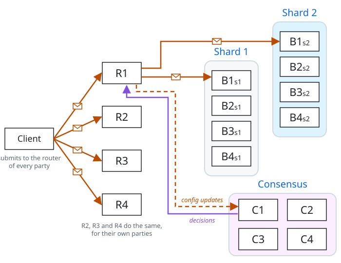
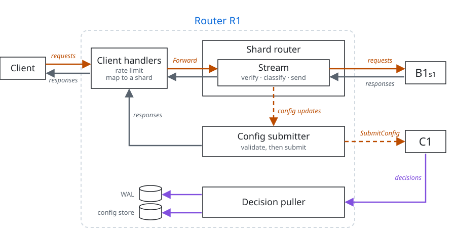

<!--
Copyright IBM Corp. All Rights Reserved.

SPDX-License-Identifier: Apache-2.0
-->
# Router

*Audience: submitting clients and their operators, ordering-service operators, and contributors to
the router implementation.*

This document describes the **router**, the Fabric-X Orderer node that accepts transactions from
clients. It covers the interface a client uses to submit transactions, the internal design and
algorithms a contributor needs to work on the component, and the configuration, recovery, and
failure behavior an operator needs to run it. It focuses on the router; for the end-to-end system
flow and how the router relates to the other three roles, start with the
[architecture overview](architecture.md).

1. [Overview](#1-overview)
    1. [Units and Terms](#11-units-and-terms)
2. [Submitting Transactions: the Client Interface](#2-submitting-transactions-the-client-interface)
3. [Design and Internal Architecture](#3-design-and-internal-architecture)
    1. [Units and Wiring](#31-units-and-wiring)
    2. [Mapping Requests to Shards](#32-mapping-requests-to-shards)
    3. [Verification and Classification](#33-verification-and-classification)
    4. [Forwarding to the Batcher](#34-forwarding-to-the-batcher)
    5. [Configuration Updates](#35-configuration-updates)
    6. [Following the Decisions of Consensus](#36-following-the-decisions-of-consensus)
    7. [Code Map](#37-code-map)
4. [Configuration](#4-configuration)
5. [Metrics and Monitoring](#5-metrics-and-monitoring)
6. [Failure and Recovery](#6-failure-and-recovery)
    1. [Restarting from Local State](#61-restarting-from-local-state)
    2. [When Other Nodes Fail](#62-when-other-nodes-fail)
7. [Reconfiguration](#7-reconfiguration)
8. [Deployment Guidance](#8-deployment-guidance)
9. [Further Reading](#9-further-reading)

## 1. Overview

The **router** ([`node/router`](../node/router)) is the party-local entry point of the ordering
service, and the first stage of the Arma pipeline (**Router → Batcher → Consenter → Assembler**). It
has two roles: it **maps** each incoming transaction to a shard and forwards it to the batcher of its
own party in that shard, and it **verifies** each transaction, dropping it if it is invalid. Because
every router maps a transaction to the same shard, a client that submits a transaction to the
routers of all parties has it reach every correct batcher of that shard, which is what makes the
service resistant to censorship.

<picture>
  <source media="(prefers-color-scheme: dark)" srcset="figures/router-context-dark.svg">
  
</picture>

*Figure 1: The router's place in the pipeline — clients submitting to the routers of all parties,
each router forwarding to the batcher of its own party in every shard, and configuration updates
going to the consenter of its party. The nodes shown are part of a network of 4 parties and 2
shards; R1, C1 and B1 belong to party 1.*

### 1.1 Units and Terms

Three units do the router's central work, on the data and state named below; the units around them
are named in [Units and Wiring](#31-units-and-wiring). The terms the router is defined in are
system-wide: the data items among them — request and batch — are defined in the
[data model](architecture.md#5-data-model) of the architecture overview, and party, shard and
batcher in the overview itself.

**Units**

- **Shard router** — one per shard. It holds the router's connections and streams to the batcher of
  its own party in that shard, and forwards each request mapped to the shard on one of those streams.
- **Stream** — one gRPC stream to a batcher. Each stream verifies and classifies the requests it
  carries, sends the valid ones to the batcher, and returns the responses to the clients.
- **Config submitter** — the unit that takes configuration updates, validates them, and submits
  them to the consenter of the router's party.

**Terms**

- **Request identifier** (reqID) — a CRC64 checksum of a request's payload. It decides the request's
  shard, and the stream that carries it.
- **Traced** and **untraced requests** — a request submitted through `Submit` or `SubmitStream` is
  traced: the router waits for the batcher's response to it. A request submitted through `Broadcast`
  is untraced: the router responds as soon as the request is sent to the batcher.
- **Config store** — the config blocks the router has received from consensus, on local storage.
- **WAL** — a write-ahead log holding the last decision the router read from consensus. With the
  config store, it is where the router resumes after a restart.

## 2. Submitting Transactions: the Client Interface

The router serves Fabric's Atomic Broadcast `Broadcast` service.

```protobuf
service AtomicBroadcast {
  // broadcast receives a reply of Acknowledgement for each common.Envelope in order, indicating
  // success or type of failure
  rpc Broadcast(stream common.Envelope) returns (stream BroadcastResponse);
}
```

A client opens a `Broadcast` stream and sends signed `common.Envelope`s on it, a transaction or a
configuration update each, and receives one `BroadcastResponse` per envelope. Since no single router
is trusted, a correct client submits each transaction to the routers of all parties.

A `SUCCESS` response means the router accepted the transaction and handed it to a batcher; it does
not mean the transaction was ordered, and the client learns that from the blocks it reads from the
assemblers. A configuration update is the exception: its response comes after the consenter of the
router's party has answered it, and a `SUCCESS` then means only that the consenter accepted it into
consensus, not that it was ordered. Every other outcome is either `SERVICE_UNAVAILABLE`, when the
router's rate limit rejects the request, or `INTERNAL_SERVER_ERROR`, with an `Info` message that tells
a request the router found invalid apart from a router that could not reach its batcher. An invalid
request does not end the stream, and the client may go on sending on it.

Two properties of these responses differ from what a Fabric client may expect. They are not
necessarily returned in the order the envelopes were sent: the envelopes of one stream are spread
over shards and over the router's streams to each batcher, which answer independently, and a
`BroadcastResponse` carries no identifier to match it with its envelope. And they are buffered for
each client up to a limit: a client that stops reading its responses loses the ones that do not fit,
rather than slowing the router down for every other client. The router counts those losses, and logs
a warning for a client that stays connected but falls behind.

The router also serves the `RequestTransmit` service, an alternative to `Broadcast` that carries the
same requests in Arma's own message, as a single request or as a stream. Its responses carry an error
string, empty on success, and a successful response is given only once the batcher has answered the
request. For a configuration update the consenter answers instead, and an empty error means only that
it accepted the update into consensus, not that the update was ordered.

```protobuf
service RequestTransmit {
  rpc Submit(Request) returns (SubmitResponse);
  rpc SubmitStream(stream Request) returns (stream SubmitResponse);
}
```

Access to the router is controlled at two levels. When mutual TLS is enabled, a client connects only
with a TLS certificate issued by a trusted root: the ordering service's, an application's in the
channel configuration, or one listed in the router's local configuration. When
`ClientSignatureVerificationRequired` is set, the router also verifies the signature of every
request against the channel's `Writers` policy. Signature verification is compute intensive, so
without it the router relies on mutual TLS alone, a session-based form of authorization; the
signature of a configuration update is verified either way. Neither check concerns the endorsements
inside a transaction, which only the committer evaluates.

## 3. Design and Internal Architecture

Every request takes the same path through the router: the router maps it to a shard, the shard
router puts it on one of its streams to the batcher of that shard, and the stream verifies it,
classifies it, and either sends it to the batcher or hands it to the config submitter. Alongside that
path, the router follows the decisions of consensus, to learn of new configurations.

### 3.1 Units and Wiring

Besides the shard routers, their streams and the config submitter, a router runs a **decision
puller**, which pulls decisions from the consenter of its own party; the config store and the WAL,
which hold its state; and a **rate limiter**, which admits or rejects each request before it is
forwarded. The `Broadcast`, `Submit` and `SubmitStream` handlers run in the goroutines gRPC gives each
client call, and a client stream has one more goroutine that sends its responses. Each stream to a
batcher has two goroutines: one sends requests to the batcher, verifying and classifying each one
first, and the other reads the batcher's responses. A shard router has one more goroutine, which
reconnects the streams that fail. The config submitter runs in one goroutine, and decisions are
pulled and processed in goroutines of their own.

<picture>
  <source media="(prefers-color-scheme: dark)" srcset="figures/router-units-dark.svg">
  
</picture>

*Figure 2: The router's units, and how requests, responses and configuration updates move between
them.*

### 3.2 Mapping Requests to Shards

Requests are mapped to shards deterministically, so that every router sends a given request to the
same shard, and as close to uniformly as possible, so that the shards share the load. The router
computes a CRC64 checksum of the request's payload, which needs neither collision resistance nor
one-wayness, and is cheaper than a cryptographic hash. The checksum, as 8 bytes, is the request
identifier. Its trailing two bytes, reduced modulo the number of shards, select the shard; its
leading four bytes, reduced modulo the number of streams to that shard's batcher, select the stream.
A request is therefore always carried on the same stream, and the streams share the load the same
way the shards do.

### 3.3 Verification and Classification

Verification runs in the stream, not in the client's handler, so the router verifies as many requests
in parallel as it has streams: connections per batcher × streams per connection × shards. Each request
is checked in three levels, and a request that fails any of them is answered with an error and goes no
further:

1. **Rules** — the payload must not be empty, and the payload and signature together must not exceed
   `RequestMaxBytes`.
2. **Structure, signature and policy** — the payload must be a `common.Payload` with a channel header
   and a signature header, whose creator identity must decode; and, when
   `ClientSignatureVerificationRequired` is set or the request is a configuration update, its signature
   must satisfy the channel's `Writers` policy.
3. **Type** — the request's type is taken from its channel header. A configuration update goes to
   the config submitter, and any other supported type to the batcher; a config block, an orderer
   transaction, or a deliver request is rejected, as is a type above the known range.

### 3.4 Forwarding to the Batcher

A shard router holds a pool of gRPC connections to the batcher of its own party in its shard, and a
fixed number of streams on each, opened at startup. For a traced request, the stream registers it
under a trace ID before sending, and returns the batcher's response when it arrives; for an untraced
one, it responds as soon as the send succeeds.

A stream whose send or receive fails is marked faulty: every request still waiting on it, sent or
queued, is answered with an error for the client to resubmit, and the shard router's reconnection
goroutine is asked to repair it. That goroutine redials the connection if it is down, with a backoff
from 50 ms to 10 s, and opens a new stream in place of the faulty one. When the batcher reports that it
is stopping, the stream waits out the same backoff before asking for its repair. Meanwhile, a request
mapped to a faulty stream is answered with an error at once, rather than queued.

### 3.5 Configuration Updates

A configuration update is answered by consensus rather than by a batcher, so a stream hands it to the
config submitter, which processes the updates one at a time; when its queue of 100 is full, a further
update is rejected at once rather than left waiting. For each, the submitter proposes the
configuration it leads to, only to check it against the configuration rules and against the rules for
the transition from the current configuration; it then submits the client's own update, not the
proposal, to the consenter of its party with `SubmitConfig`, which proposes it again itself. The
connection is retried with the same backoff as the streams. The client receives the consenter's
response, or the reason the router rejected the update.

### 3.6 Following the Decisions of Consensus

The router learns of a new configuration the way every other node does, from the decisions of
consensus, which the decision puller streams from the consenter of the router's party. The puller
signs its request with the router's identity and binds it to the router's TLS certificate, and the
consenter serves it only if that identity satisfies `/Channel/Orderer/Readers`. The router writes each
decision to its WAL, keeping only the last one. A decision that carries a config block
newer than the last in the config store has that block added to the store, after which the router
stops pulling and applies the new configuration (see [Reconfiguration](#7-reconfiguration)).

### 3.7 Code Map

| Concept | Source |
|---------|--------|
| Node lifecycle, client handlers, decision processing, applying a new config | [`router.go`](../node/router/router.go) |
| Mapping a request to a shard | [`mapper.go`](../node/router/mapper.go) |
| Connections, streams and reconnection to one batcher | [`shard_router.go`](../node/router/shard_router.go), [`stream.go`](../node/router/stream.go) |
| Request rules, structure and signature checks | [`common/requestfilter`](../common/requestfilter) |
| Configuration updates | [`config_submitter.go`](../node/router/config_submitter.go) |
| Decision puller | [`decision_puller.go`](../node/router/decision_puller.go), [`consensus_decision_deliver_client.go`](../node/delivery/consensus_decision_deliver_client.go) |
| Rate limiting | [`throttle.go`](../node/router/throttle.go), [`common/ratelimit`](../common/ratelimit) |
| Client responses | [`client_feedback.go`](../node/router/client_feedback.go), [`tracked_request.go`](../node/router/tracked_request.go) |
| Config store | [`common/configstore`](../common/configstore) |
| Metrics | [`metrics.go`](../node/router/metrics.go) |

## 4. Configuration

A router is configured like every other node: a local YAML file for what this node is and where it
keeps its state, and the shared configuration for what the network is, which it obtains from a config
block. The sections common to all roles — `General`, `FileStore`, `Operations` and `Metrics` — are
documented field by field in the commented [`local_config.yaml`](../config/sample/local_config.yaml),
and the [configuration model](architecture.md#6-configuration-and-membership) of the architecture
overview explains how local and shared configuration fit together. Three of them decide how a router
behaves: `General.Bootstrap` names the block it bootstraps from; `General.ClientSignatureVerificationRequired`
decides whether it verifies the signatures of requests; and `FileStore.Location` is the directory
that holds its config store and WAL. The role-specific section is `Router`:

```yaml
# Router specific parameters
Router:
  NumberOfConnectionsPerBatcher: 10
  NumberOfStreamsPerConnection: 5
  Throttling:
    Policy: disabled
    Rate: 0
    Burst: 0
```

| Field | Default | What it controls |
|-------|---------|------------------|
| `NumberOfConnectionsPerBatcher` | 10 | How many gRPC connections each shard router opens to its batcher. |
| `NumberOfStreamsPerConnection` | 5 | How many streams each of those connections carries. Together with the connections and the shards, it sets how many requests the router verifies in parallel, so it is the setting to size to the machine's cores. |
| `Throttling.Policy` | `disabled` | `disabled`, or `global` for a single rate limit shared by every client of the router. Throttling is per router: each router limits its own ingress. |
| `Throttling.Rate` | — | Under `global`, the requests per second the router admits; it must be positive, or the router does not start. |
| `Throttling.Burst` | `Rate` | Under `global`, how many requests the router admits at a single instant before the rate applies. |

A request over the rate is rejected at once, with `SERVICE_UNAVAILABLE`, rather than slowed down.

From the shared configuration a router takes the topology it works against: every shard and the
batcher of its own party in it, which is where its shard routers connect; the consenter of its own
party, where it submits configuration updates and pulls decisions; `RequestMaxBytes` from the batching
configuration, the largest request it accepts; and the channel configuration carried in the config
block, which gives it the `Writers` policy its signature check uses and the application roots its
TLS trusts. None of this is in the local file, and all of it except the set of shards can be changed
through a new config block (see [Reconfiguration](#7-reconfiguration)).

Templates can be found under [`config/sample`](../config/sample):
[`local_config_router.yaml`](../config/sample/local_config_router.yaml) for this role, and
[`shared_config.yaml`](../config/sample/shared_config.yaml) for the network-wide part.

## 5. Metrics and Monitoring

A router exposes its metrics in Prometheus format on the operations endpoint configured by
`Operations.ListenAddress` and `Operations.ListenPort`, alongside a health check, a logging-spec
endpoint and version information. When `Metrics.MetricsLogInterval` is non-zero the node also writes a
periodic `ROUTER_METRICS` line to its log, with the requests arrived so far and per second over the
last interval, the requests forwarded, rejected and throttled, and the active client streams.

The router's metrics are each labelled with the party ID:

| Metric | What it tells you |
|--------|-------------------|
| `router_requests_arrived` | How many requests have arrived at the router. |
| `router_requests_forwarded` | How many requests the router has forwarded, by a `shard_id` label: to that shard's batcher, or, labelled `consensus`, a configuration update to the consenter. The gap from `router_requests_arrived` is what the router turned away or has not yet forwarded. |
| `router_requests_rejected` | How many requests the router has answered with an error, by a `code` label: `400` for a request that failed verification, `500` for one it could not forward, or a full config update queue. Only `Broadcast` errors are counted: on `Submit` and `SubmitStream` the error travels in the response, which the count does not see. Config updates rejected by validation or by the consenter are not counted either. |
| `router_requests_throttled` | How many requests the rate limit rejected. |
| `router_active_streams` | How many client streams are open, by a `stream_type` label: `broadcast` or `submit_stream`. |
| `router_submit_invocations` | How many times the unary `Submit` was called. |
| `router_responses_dropped` | How many responses never reached their client, by a `reason` label: `client_gone`, `client_behind` or `router_draining`. A dropped error response still counts in `router_requests_rejected`. |
| `router_batcher_connected` | Per `shard_id`: 1 while the router has at least one healthy stream to that shard's batcher, 0 otherwise. |
| `router_batcher_reconnects` | Per `shard_id`: how many times the router's connection to that shard's batcher was restored after it was fully lost. |

Besides its metrics, a node keeps a status of its own, which moves between five states:
`initializing` while it starts up or takes a new configuration, `running` once it is serving,
`soft-stopped` while it is between configurations, `pending-admin` when a configuration change needs
an administrator, and `stopped`. The status is not published on the operations endpoint, so the node's
log is where these transitions are visible.

The full list of metrics for every role, and how to collect and visualize them, is in the
[monitoring and metrics guide](monitoring/metrics.md).

## 6. Failure and Recovery

### 6.1 Restarting from Local State

The router holds no transactions: a request it accepted has already been handed to a batcher, and one
it had not yet forwarded is lost with it, to be resubmitted by the client. What it persists is what it
needs to follow consensus. On a restart it resumes pulling decisions from the decision in its WAL,
pulling that decision again in case the router stopped before storing the config block it carried.
When the WAL is empty it resumes after the decision of the last block in its config store, or from the
first decision if that block is the genesis block. The router also starts from the last block in its
config store rather than from its bootstrap block, so a restarted router comes back on the
configuration it last applied.

### 6.2 When Other Nodes Fail

If the batcher of the router's party in a shard is unreachable, its streams turn faulty, and every
request mapped to that shard is answered with an error at once until the shard router reconnects;
`router_batcher_connected` shows it as 0 for that shard meanwhile. The
other shards are not affected, and since a correct client submits to the routers of all parties, the
batchers of the other parties in that shard still receive the transaction. If the consenter of the
router's party is unreachable, configuration updates wait while the config submitter retries, until
its queue is full and further ones are rejected at once; the router also does not learn of new
configurations. Regular transactions are not affected.

## 7. Reconfiguration

A new configuration reaches the router in the decision stream, as a config block (see
[Following the Decisions of Consensus](#36-following-the-decisions-of-consensus)). The router then
**soft stops**: it stops accepting requests, answers every request still waiting on its streams with
an error — though on `Broadcast` and `SubmitStream` the configuration updates still queued in the
config submitter go unanswered — waits until the responses already queued for each client are sent,
and then stops its network service. Once the soft stop is done and the new configuration is built,
it acknowledges the configuration sequence to its consenter and waits for the reply, before deciding
whether it can apply it.

If the new configuration evicts the router's party, or changes this node's endpoint, TLS certificate
or signing certificate, the router enters the **pending-admin** state and waits for an administrator,
until its local configuration is updated and the process restarted. Anything else it applies on its
own: it builds its new configuration, recreates its shard routers, config submitter and decision
puller against the new topology, and starts serving again, without restarting the process. The
decision puller resumes from the decision that carried the config block. A client whose stream was
cut by the soft stop reconnects and resubmits.

For the configuration model this rests on, see
[Configuration and Membership](architecture.md#6-configuration-and-membership).

## 8. Deployment Guidance

<!-- Section 8 placeholder -->
*To be written: what to provision a router with — compute for signature verification, and network
and endpoint considerations.*

## 9. Further Reading

- [Architecture overview](architecture.md) — the four roles, the end-to-end flow, and the
  configuration model.
- [APIs](api.md) — the gRPC services of every role, and which role implements which.
- [Monitoring and metrics](monitoring/metrics.md) — the full list of metrics, and how to collect and
  visualize them.
- [Deployment](../deployment/README.md) — how the nodes of a network are laid out over machines.
- [`arma` CLI](cli/arma.md) — the node binary and its subcommands.
- [`node/router`](../node/router) — the source.
